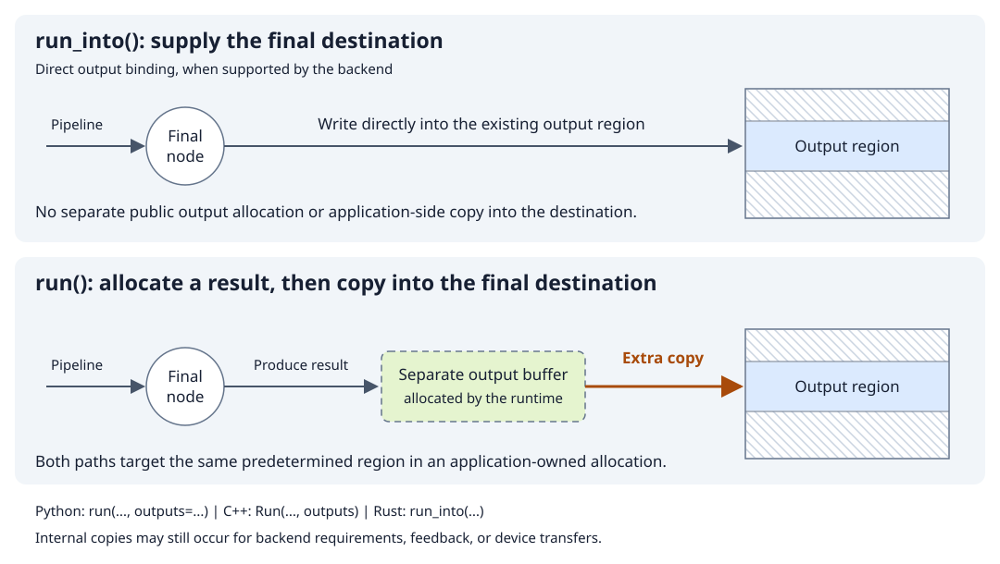

Memory and Tensor Types
=======================

The runtime exchanges tensors through DLPack 1.0. Tensor wrappers describe
storage and retain ownership; array operations, dtype conversion, and device
transfers belong to your application or tensor library.

Supported element types are Boolean, unsigned and signed 8/16/32/64-bit integers,
``float16``, ``bfloat16``, ``float32``, and ``float64``. A model backend can support a narrower
set; match the bundle port descriptor and that backend's requirements. DLPack
lanes must be one, and non-native byte order and strided layouts require an
explicit conversion before inference.

Execution and storage placement
-------------------------------

CPU memory is ordinary host storage. Pinned CPU memory is page-locked host
storage, useful for CUDA transfers but requiring CUDA for allocation. CUDA memory
belongs to a specific device and must not be dereferenced on the host.

Execution device and public output location are independent. CPU outputs are
convenient for host consumers; CUDA outputs avoid a device-to-host transfer when
the next consumer also runs on the GPU. Pinned output placement can help a
pipeline that transfers host results again, but still involves transfers and
page-locked memory costs. Initial/default inputs and private feedback reside on
the execution device. See :doc:`session_options` for placement configuration.

Wrappers by language
--------------------

.. tab-set::

   .. tab-item:: Python
      :sync: python

      Inputs are DLPack producers, including NumPy arrays, PyTorch tensors, and
      CuPy arrays. Results contain minimal ``DLPackOutput`` objects implementing
      the two DLPack protocol methods. Import one with ``np.from_dlpack``,
      ``torch.from_dlpack``, or ``cp.from_dlpack``.

      These imports share storage when supported. NumPy may expose a read-only
      view; call ``copy()`` for a writable independent array. Explicit DLPack
      ``copy=True`` or cross-device export requests raise ``BufferError``;
      perform copies or transfers in the consumer. ``copy=False`` and
      ``copy=None`` are supported. There is no runtime ``Tensor``, ``.numpy()``,
      or ``.dlpack_view()`` convenience API.

   .. tab-item:: C++
      :sync: cpp

      ``NamedTensor`` associates a public name with a borrowed ``DLTensor``
      descriptor. Inputs and writable outputs retain caller ownership.
      Keep the descriptor, shape/strides, and allocation alive until ``Run``
      returns. A null stride pointer denotes compact layout; honor byte offsets
      when inspecting returned descriptors.

      ``RunResult::GetTensor`` creates a fresh DLPack lease as ``ManagedTensor``,
      a ``unique_ptr<DLManagedTensorVersioned, DLPackDeleter>``. Destruction invokes
      the standard deleter. ``release()`` transfers the lease to another DLPack
      consumer, which must call its deleter exactly once. Multiple leases can
      share writable storage. Use CUDA or a framework for device transfers.

   .. tab-item:: Rust
      :sync: rust

      ``BorrowedTensor::cpu(&values, &shape)`` infers dtype, checks shape, and
      retains immutable slice borrows. It accepts fixed-width integers and
      ``f32``/``f64``; booleans and half floats require raw descriptors.
      ``as_cpu_slice`` safely reads a borrowed host tensor without copying.

      ``OutputBuffer::cpu(&mut values, &shape)`` retains an exclusive mutable
      borrow for output writes. Raw DLPack constructors are unsafe: the caller
      guarantees descriptor validity, allocation bounds, readiness, and storage
      lifetime. Output storage must be writable and disjoint from other buffers.

      ``SharedTensor`` retains runtime-produced storage. Clones share its
      allocation. ``to_cpu_vec::<T>()`` checks dtype/layout and creates an owned
      copy from CPU, pinned CPU, or CUDA memory. CUDA copies finish before return
      and restore the caller's selected device. Call it before exposing storage
      through ``descriptor()`` or ``export()`` on any clone; it rejects previously
      exposed storage because foreign consumers may write it concurrently.

      ``descriptor()`` exposes a DLPack descriptor; dereferencing its raw storage
      pointers requires the appropriate unsafe contract.
      ``export(true).into_raw()`` transfers a fresh managed lease to a foreign
      consumer, which must invoke that lease's deleter exactly once.
      ``ManagedTensor`` owns one imported producer lease on the importing thread.
      Constructing ``SharedTensor`` from arbitrary foreign storage requires its
      explicit unsafe ownership contract.

Prepare input memory
--------------------

These input allocations and tensor views are the ones used in
:doc:`getting_started`. Keep them alive through the synchronous session call.

.. tab-set::

   .. tab-item:: Python
      :sync: python

      .. code-block:: python

         import numpy as np

         # Input memory: NumPy owns these contiguous float32 arrays.
         inputs = {
             "control/joint_pos": np.zeros(6, dtype=np.float32),
             "control/joint_vel": np.zeros(6, dtype=np.float32),
             "control/orientation": np.array([1, 0, 0, 0], dtype=np.float32),
             "control/cmd_vel": np.array([0.5, 0, 0.1], dtype=np.float32),
         }

   .. tab-item:: C++
      :sync: cpp

      .. code-block:: cpp

         #include <leapp/runtime.h>
         #include <array>

         // Input memory: these arrays own the float32 data.
         std::array<float, 6> pos{}, vel{};
         std::array<float, 4> quat{1, 0, 0, 0};
         std::array<float, 3> cmd{0.5f, 0, 0.1f};

         // DLTensor descriptors borrow the data and shape storage.
         // Keep all of them alive until Run returns.
         int64_t six = 6, four = 4, three = 3;
         DLTensor p{pos.data(), {kDLCPU, 0}, 1, {kDLFloat, 32, 1}, &six, nullptr, 0};
         DLTensor v{vel.data(), {kDLCPU, 0}, 1, {kDLFloat, 32, 1}, &six, nullptr, 0};
         DLTensor q{quat.data(), {kDLCPU, 0}, 1, {kDLFloat, 32, 1}, &four, nullptr, 0};
         DLTensor c{cmd.data(), {kDLCPU, 0}, 1, {kDLFloat, 32, 1}, &three, nullptr, 0};

   .. tab-item:: Rust
      :sync: rust

      .. code-block:: rust

         use lrt::dlpack::BorrowedTensor;
         use std::collections::HashMap;

         // Input memory: these arrays own the float32 data.
         let pos = [0.0_f32; 6];
         let vel = [0.0_f32; 6];
         let quat = [1.0_f32, 0.0, 0.0, 0.0];
         let cmd = [0.5_f32, 0.0, 0.1];

         // Borrow the arrays as tensor views; keep them alive through run.
         let inputs = HashMap::from([
             ("control/joint_pos", BorrowedTensor::cpu(&pos, &[6])?),
             ("control/joint_vel", BorrowedTensor::cpu(&vel, &[6])?),
             ("control/orientation", BorrowedTensor::cpu(&quat, &[4])?),
             ("control/cmd_vel", BorrowedTensor::cpu(&cmd, &[3])?),
         ]);

Read an output
--------------

These snippets use ``result`` from :doc:`getting_started`.

.. tab-set::

   .. tab-item:: Python
      :sync: python

      .. code-block:: python

         # Output memory: share the returned allocation through DLPack.
         targets = np.from_dlpack(result["control/joint_targets"])
         print(targets)

         # Make an independent writable copy when needed.
         independent_targets = targets.copy()

   .. tab-item:: C++
      :sync: cpp

      .. code-block:: cpp

         // Output memory: retain a managed lease on the returned tensor.
         lrt::ManagedTensor targets;
         auto status = result.GetTensor("control/joint_targets", &targets);
         if (!status.ok()) return 1;

         // Read the CPU float32 data, honoring the descriptor's byte offset.
         const auto& t = targets->dl_tensor;
         const auto* data = reinterpret_cast<const float*>(
             static_cast<const char*>(t.data) + t.byte_offset);
         for (int i = 0; i < 6; ++i) std::cout << data[i] << '\n';

         // Keep targets alive while reading the descriptor or its storage.

   .. tab-item:: Rust
      :sync: rust

      .. code-block:: rust

         // Output memory: copy the managed tensor into an owned CPU vector.
         let targets = result.get("control/joint_targets").ok_or("missing targets")?;
         println!("{:?}", targets.to_cpu_vec::<f32>()?);

Where copies happen
-------------------

``run()`` allocates public outputs for you; ``run_into()`` writes into buffers
you supply. ``run_into()`` is the Rust name for this operation. Python uses
``run(inputs, outputs=...)`` and C++ uses ``Run(inputs, &result, outputs)``.

         buffer. run allocates a separate result that must be copied into it.
   :width: 100%

   When the application already has a destination buffer, supplying it can
   avoid a separate result allocation and the extra copy into that destination.

Borrowing compatible input buffers avoids staging where the backend permits
direct binding. Copies can still protect inputs from model mutation, isolate
feedback, move outputs to a requested location, or detach returned results from
reusable workspace. Supplying output buffers permits direct output binding and
avoids allocating those public results. Retaining an allocated result does not
pin the session workspace or allow a later call to overwrite that result.

Compare the two calls
^^^^^^^^^^^^^^^^^^^^^

These snippets use the open CPU session and inputs from :doc:`getting_started`.
Assume a downstream consumer requires the six joint targets in an existing
``target_buffer`` whose address cannot change. With ``run()``, copy the returned
values into that buffer. With supplied outputs, the runtime can bind the final
node directly to that same buffer when the backend supports it. Both paths
leave the values at the required address. Backend workspace and internal copies
may still be needed. The C++ snippet uses ``<algorithm>`` for ``std::copy_n``.

.. tab-set::

   .. tab-item:: Python
      :sync: python

      .. code-block:: python

         # ------------------------------------------------------------------
         # Existing destination
         # Required by the application; keep its address fixed.
         # ------------------------------------------------------------------
         target_buffer = np.empty(6, dtype=np.float32)

         # ------------------------------------------------------------------
         # run(): allocated output
         # Allocate a separate output, then copy into the final destination.
         # ------------------------------------------------------------------
         result = session.run(inputs)
         targets = np.from_dlpack(result["control/joint_targets"])
         # from_dlpack shares result storage; copyto performs the extra copy.
         np.copyto(target_buffer, targets)

         # ------------------------------------------------------------------
         # Supplied output buffer
         # Write into the same destination without the extra application-side copy.
         # ------------------------------------------------------------------
         remaining = session.run(
             inputs, outputs={"control/joint_targets": target_buffer}
         )
         assert "control/joint_targets" not in remaining.keys()

   .. tab-item:: C++
      :sync: cpp

      .. code-block:: cpp

         /*
          * Existing destination
          * Required by the application; keep its address fixed.
          */
         std::array<float, 6> target_buffer{};

         /*
          * Run(): allocated output
          * Allocate a separate output, then copy into the final destination.
          */
         lrt::RunResult result;
         auto status = session.Run(
             {{"control/joint_pos", &p}, {"control/joint_vel", &v},
              {"control/orientation", &q}, {"control/cmd_vel", &c}}, &result);
         if (!status.ok()) return 1;
         lrt::ManagedTensor targets;
         status = result.GetTensor("control/joint_targets", &targets);
         if (!status.ok()) return 1;
         const auto& t = targets->dl_tensor;
         const auto* data = reinterpret_cast<const float*>(
             static_cast<const char*>(t.data) + t.byte_offset);
         std::copy_n(data, target_buffer.size(), target_buffer.data());  // Extra copy.

         /*
          * Supplied output buffer
          * Write into the same destination without the extra application-side copy.
          */
         int64_t target_shape[] = {6};
         DLTensor output{target_buffer.data(), {kDLCPU, 0}, 1,
                         {kDLFloat, 32, 1}, target_shape, nullptr, 0};
         lrt::RunResult remaining;
         status = session.Run(
             {{"control/joint_pos", &p}, {"control/joint_vel", &v},
              {"control/orientation", &q}, {"control/cmd_vel", &c}},
             &remaining, {{"control/joint_targets", &output}});
         if (!status.ok()) return 1;
         // remaining omits the supplied output; read target_buffer directly.

   .. tab-item:: Rust
      :sync: rust

      .. code-block:: rust

         use lrt::dlpack::{BorrowedTensor, OutputBuffer};
         use std::collections::HashMap;

         /*
          * Existing destination
          * Required by the application; keep its address fixed.
          */
         let mut target_buffer = [0.0_f32; 6];

         /*
          * run(): allocated output
          * Allocate a separate output, then copy into the final destination.
          */
         let result = session.run(&inputs)?;
         let targets = result.get("control/joint_targets").ok_or("missing targets")?;
         // SAFETY: result retains ready CPU storage; no exported aliases or writers
         // exist, and targets stays alive throughout this immutable borrow.
         let view = unsafe { BorrowedTensor::new(targets.descriptor()) };
         target_buffer.copy_from_slice(view.as_cpu_slice::<f32>()?);  // Extra copy.

         /*
          * run_into(): supplied output buffer
          * Write into the same destination without the extra application-side copy.
          */
         {
             let mut outputs = HashMap::from([
                 ("control/joint_targets", OutputBuffer::cpu(&mut target_buffer, &[6])?),
             ]);
             let remaining = session.run_into(&inputs, &mut outputs)?;
             assert!(remaining.get("control/joint_targets").is_none());
         }
         // The mutable borrow has ended; target_buffer contains the output.

Layout and lifetime requirements
^^^^^^^^^^^^^^^^^^^^^^^^^^^^^^^^

Contiguous layout is required. Materialize strided inputs with
``np.ascontiguousarray``, PyTorch ``contiguous()``, or ``cp.ascontiguousarray``.
The runtime does not silently normalize a strided view or change its dtype.
Keep all producer and consumer owners alive until their work completes; multiple
exports of one result may alias, so concurrent reads and writes require caller
synchronization.

CUDA graph replay keeps bindings across calls. Retain those CUDA allocations
until the session closes, update their contents in place, and keep the required
alignment and shapes fixed. This is a longer storage lifetime than ordinary
synchronous borrowing. See :ref:`runtime-cuda-graph-replay`.
